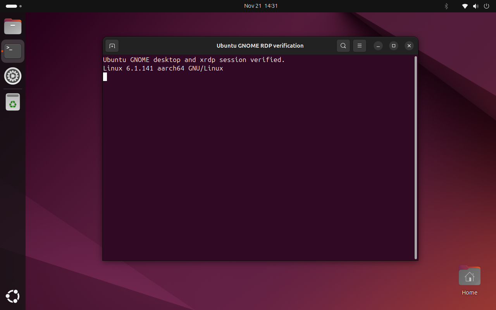

# KICKPI K1Mini：Ubuntu GNOME 桌面与 RDP 部署记录

> **后续完整记录：** [gnome.md](gnome.md) 包含本地 HDMI 黑屏、点击无反应、最终切换 fbdev、调整为 2560×1440 以及键盘正常的确认。下文主要保留初次部署过程；其中 Mesa-only 和多屏扩展描述属于中间状态，最终本地配置以 `gnome.md` 为准。当前分辨率为运行时设置，尚未配置开机恢复。

配置日期：2026-11-21。通过 SSH 连接 `kickpi@192.168.3.181`，使用 sudo 完成安装和配置。本文对应当前 K1Mini 系统；原先 Ubuntu 20.04 / K1A 的设备资料仍保存在 [Rk3568.md](Rk3568.md)。

## 最终状态与连接方法

系统已从 XFCE 默认会话切换为 **Ubuntu GNOME on Xorg**：左侧 Ubuntu Dock、顶部状态栏、Yaru 主题、文件管理器、设置与 GNOME 终端。用户所说的“Ubuntu 22.04 默认桌面”按这一布局实现。底层系统仍是 **Ubuntu 24.04.4 LTS**，因此使用 GNOME 46，而非 Ubuntu 22.04 的 GNOME 42。没有执行系统降级或重刷镜像。

Windows 按 `Win + R`，输入 `mstsc`，连接：

| 项目 | 值 |
|---|---|
| 计算机 | `192.168.3.181:3389` |
| 用户名 | `kickpi` |
| 密码 | 当前 kickpi 账户密码；本文不保存口令 |
| xrdp 登录窗口中的 Session | `Xorg` |
| 推荐初始分辨率 | `1280×800`，确认流畅后再提高 |

xrdp 默认使用板端自签名证书，Windows 首次连接可能要求确认服务器证书。RDP 创建独立桌面会话，不是对 HDMI 桌面的镜像。本次已验证本地 GNOME 和同账户的独立远程 GNOME 能同时运行。

RDP 会话使用 CPU 软件渲染，在 RK3568 上高分辨率和桌面特效会增加负担；已关闭 GNOME 动画。关闭远程桌面窗口会保留会话，使用桌面“注销”会结束会话。

## 当前系统与安装的软件

| 项目 | 实测值 |
|---|---|
| 运行时设备树型号 | Rockchip RK3568 KICKPI K1Mini Board |
| 发行版 | Ubuntu 24.04.4 LTS / noble / arm64 |
| 内核 | `6.1.141 #4 SMP Wed Sep 2 15:59:40 CST 2026 aarch64` |
| 内存 | 约 3.8 GiB；未配置 swap |
| 安装后根分区 | 29 GiB，总使用约 6.4 GiB，可用约 21 GiB |
| kickpi UID / GID | `1000 / 1000` |
| 显示管理器 | LightDM，保留原有 kickpi 自动登录 |
| 本地默认会话 | `ubuntu-xorg` |
| ubuntu-desktop-minimal | `1.539.2` |
| ubuntu-session | `46.0-1ubuntu4` |
| gnome-shell | `46.0-0ubuntu6~24.04.17` |
| Ubuntu Dock | `90ubuntu3` |
| GNOME Terminal | `3.52.0-1ubuntu2` |
| xrdp | `0.9.24-4ubuntu0.1` |
| xorgxrdp | `1:0.9.19-1` |

使用现有 USTC Ubuntu Ports 软件源，先更新索引，再以 `--no-install-recommends` 安装 `ubuntu-desktop-minimal xrdp xorgxrdp dbus-x11 gnome-terminal yaru-theme-gtk yaru-theme-icon xdg-desktop-portal-gnome`。GDM3 随依赖安装，但显示管理器仍选用 LightDM。

镜像原有 2348 个 hold 包。安装前模拟确认没有删除包或更换板厂内核，仅允许安装所需的 25 个已安装依赖包更新，包括 PipeWire、AccountsService、WebKit 等。安装后恢复了原有 2348 个 hold；没有运行全系统升级或 autoremove。另外安装 FreeRDP X11 客户端及其客户端库，用于真实 RDP 登录验证。

## 配置变更

### 本地桌面

新增 `/etc/lightdm/lightdm.conf.d/90-ubuntu-gnome.conf`：

```ini
[Seat:*]
user-session=ubuntu-xorg
autologin-session=ubuntu-xorg
```

`/home/kickpi/.dmrc` 选择 `ubuntu-xorg`，AccountsService 的 kickpi 用户记录中 `Session` / `XSession` 同步为 `ubuntu-xorg`。

Yaru GTK / 图标 / 光标主题已设置，Dock 置于左侧且占满高度，固定文件管理器、终端和设置。GNOME 动画关闭以减小负载。原有用户级 Onboard 自动启动项增加 `NotShowIn=GNOME;`，避免 GNOME 登录后一直显示屏幕键盘；XFCE 的原有配置保留。

已重启 LightDM，实际启动了 Ubuntu GNOME 本地桌面。没有重启整块开发板。

### HDMI 黑屏修复补充

初次部署只验证了 RDP 实际画面，本地桌面仅检查了进程，遗漏了 HDMI 的实际渲染验证。用户随后报告 HDMI 有信号但全黑。补充排查时，HDMI 状态为 `connected/enabled`、`link-status=Good`，输出 `2560×1440@60Hz`；本地 GNOME Shell 正在运行，但取得的本地屏幕截图全黑。

该 GNOME Shell 进程继承 `COGL_DRIVER=gles2`，实际加载了板厂 `/usr/lib/aarch64-linux-gnu/mali/libEGL.so.1` 和 `libmali.so.1.9.0`，日志有 `Failed to query buffer age, got error 300d`。RDP 已通过独立的 Mesa 软件渲染路径正常工作。本地 GNOME 切换到 Mesa 后，截图和用户看到的 HDMI 桌面同时恢复，确认是本地 GNOME 与板厂 Mali EGL 路径的兼容问题。

新增持久化用户服务配置：

`/home/kickpi/.config/systemd/user/org.gnome.Shell@x11.service.d/50-rk3568-mesa.conf`

内容见 [gnome-shell-rk3568-mesa.conf](tools/gnome-shell-rk3568-mesa.conf)，清除 GNOME Shell 的 `COGL_DRIVER` / `LD_PRELOAD`，指定 Mesa GLX/EGL、llvmpipe 和标准库目录。作用范围仅为 kickpi 的本地 X11 GNOME Shell 服务，保留板厂 Xorg/DRM 配置。修复后实际进程加载 `libEGL_mesa`、`libGLX_mesa` 和 Mesa Gallium；用户已确认 HDMI 正常显示桌面。

软件渲染增加 CPU 开销，尤其是当前 2K HDMI 与 800×1280 DSI 扩展桌面同时启用时。配置文件会在后续登录时自动加载；本次通过重启 LightDM 验证，未额外重启开发板。诊断时重启本地 Xorg 曾出现临时启动失败，最终恢复运行并完成用户确认。

证据：[修复前本地全黑画面](rk3568-data/kickpi-hdmi-before.png)、[修复后 HDMI 与 DSI 扩展桌面](rk3568-data/kickpi-hdmi-after.png)。如要撤回该兼容配置，可将该 `.conf` 移出服务的 `.d` 目录，再执行用户服务 `daemon-reload` 并重新登录；撤回后可能再次出现黑屏。

### RDP 启动脚本与图形兼容

安装 `/home/kickpi/startwm.sh`，属主 `kickpi:kickpi`、权限 `0755`，源文件见 [xrdp-startwm-ubuntu.sh](tools/xrdp-startwm-ubuntu.sh)。xrdp 的 `EnableUserWindowManager=true` 会为 kickpi 调用该文件。

脚本保留 sesman 提供的 `DISPLAY`，清理继承的会话 D-Bus 和图形相关环境，设置 Ubuntu GNOME 的 session mode、桌面名称及配置搜索路径，再通过独立 `dbus-run-session` 启动 `gnome-session --session=ubuntu`。远程图形限定为 Mesa llvmpipe，避免虚拟显示器尝试使用 Mali 实体显示设备。

测试发现 `/etc/X11/xorg.conf.d/20-modesetting.conf` 中的板厂本地 Screen/Device 配置会被远程 Xorg 共同加载，触发 `Cannot open /dev/tty0 (Permission denied)`。为此：

1. 新建 `/etc/X11/xrdp/conf.d/`，作为远程专用的空配置片段目录。
2. `/etc/xrdp/sesman.ini` 的 `[Xorg]` 参数新增 `-configdir xrdp/conf.d`，远程 Xorg 不再读取板厂本地配置片段。
3. `/etc/X11/xrdp/xorg.conf` 设置 `AutoAddGPU=off`、`DRMDevice=""`、`DRI3=0`。

初次 RDP 部署时，本地 `/etc/X11/xorg.conf.d/20-modesetting.conf` 保留原样；后续 HDMI 排障已将它替换为 fbdev 配置，见 [完整过程](gnome.md)。远程 Xorg 仍使用独立目录。本次隔离解决的是当前镜像实测的配置冲突，不将旧系统强制 `DISPLAY=:0.0` 的问题套用于当前镜像。

### 服务与网络

`xrdp` 账户已加入 `ssl-cert` 组。`xrdp.service` 和 `xrdp-sesman.service` 均已设置开机启用并启动。

| 服务 | 状态 / 监听 |
|---|---|
| LightDM | active，本地 Ubuntu GNOME 正常运行 |
| xrdp | active / enabled，TCP `*:3389` |
| xrdp-sesman | active / enabled，回环地址 `[::1]:3350` |
| UFW | 原有状态 inactive，未更改规则 |

## 验证结果

验证覆盖了端口、认证、图形会话和应用启动：

1. Windows `192.168.3.34` 对 `192.168.3.181:3389` 的 `Test-NetConnection` 返回 `TcpTestSucceeded=True`。
2. 使用板端 FreeRDP 客户端实际连接 `127.0.0.1:3389`，kickpi 认证成功，sesman 创建了独立的 `:10` Xorg 会话。
3. 实际远程进程环境为 `XDG_CURRENT_DESKTOP=ubuntu:GNOME`、`GNOME_SHELL_SESSION_MODE=ubuntu`、`XDG_SESSION_TYPE=x11`。窗口管理器为 GNOME Shell。
4. 读取实际远程显示的截图，确认顶部栏、Ubuntu Dock、背景和桌面图标正确显示。
5. 在该远程会话内打开 GNOME Terminal，显示验证文字和 `uname -srmo`，测试终端退出码为 0。
6. 结束测试客户端和测试会话 `c7` 后，本地 GNOME 仍正常，RDP 服务保持运行。`dpkg --audit` 无输出，原有 2348 个 hold 已恢复。

FreeRDP 测试客户端在 180 秒超时后断开，日志末尾的断连发送错误对应这次主动结束测试；成功登录和桌面运行已在断开前验证。测试终端约 20 秒后自动关闭。

未使用用户的 Windows 远程桌面程序做人工操作测试，也未验证远程音频、打印机和文件重定向。

证据文件：

- [最终状态记录 JSON](rk3568-data/kickpi-gnome-rdp-validation.json)
- [远程桌面截图](rk3568-data/kickpi-ubuntu-rdp.png)
- [远程终端运行截图](rk3568-data/kickpi-ubuntu-rdp-app.png)
- [临时 Xorg / GNOME 检查脚本](tools/check_xrdp_gnome.py)，只用于技术诊断，先于真实 RDP 登录测试运行。



## 备份、维护与恢复

板端 root 专用备份目录为 `/root/codex-gnome-rdp-backup/`，包含安装前包版本、hold 清单、LightDM 配置、AccountsService 用户记录、Onboard 自动启动项、GNOME dconf 导出及安装/验证日志。`xrdp/` 子目录保存原始 `sesman.ini`、`startwm.sh`、`xorg.conf` 等服务器默认配置。

常用检查命令：

```sh
systemctl status lightdm xrdp xrdp-sesman --no-pager
ss -lntp | grep -E '3389|3350'
tail -n 80 /var/log/xrdp.log /var/log/xrdp-sesman.log
tail -n 80 /home/kickpi/.xorgxrdp.10.log
loginctl list-sessions
```

需要结束一个卡住的远程会话时，先用 `loginctl list-sessions` 识别该会话，再对对应 ID 使用 `sudo loginctl terminate-session 会话ID`。不要误结束 `seat0` 的本地会话或当前 SSH 会话。

如需恢复本地 XFCE，可在 SSH 中执行下列命令，将新增选择文件移到备份目录，并恢复原有用户会话记录。最后一条会退出当前本地桌面，先保存工作：

```sh
sudo mv /etc/lightdm/lightdm.conf.d/90-ubuntu-gnome.conf /root/codex-gnome-rdp-backup/90-ubuntu-gnome.conf.disabled
sudo mv /home/kickpi/.dmrc /root/codex-gnome-rdp-backup/dmrc-gnome
sudo cp /root/codex-gnome-rdp-backup/kickpi /var/lib/AccountsService/users/kickpi
sudo cp /root/codex-gnome-rdp-backup/onboard.desktop /home/kickpi/.config/autostart/onboard.desktop
sudo chown kickpi:kickpi /home/kickpi/.config/autostart/onboard.desktop
sudo systemctl restart accounts-daemon lightdm
```

上述恢复只改变本地桌面选择；RDP 仍通过 `/home/kickpi/startwm.sh` 启动 GNOME。XFCE 软件包一直保留，可继续使用，无须卸载 GNOME 或回退系统依赖。
