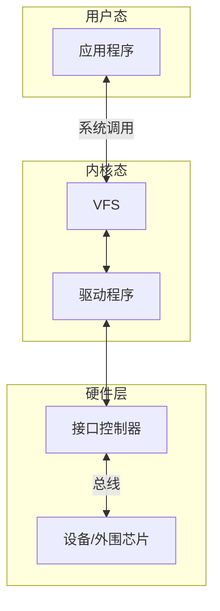

# Linux设备驱动程序入门

[TOC]

## 设备驱动程序基础

概念:所谓设备驱动程序，就是驱使设备按照用户的预期进行工作的软件，它是应用程序与设备沟通的桥梁

内核为应用空间提供一系列调用接口



Linux中的驱动程序大多以内核模块形式编写，内核模块是Linux内核向外部提供的一个接口,其全称为动态可加载内核模块

Linux内核本身为一个单内核，具有效率高的优点，也具有可扩展性和可维护性差的缺陷

内核模块机制用来弥补这个缺陷，内核模块可以被单独编译，它在运行时被链接到内核作为内核的一部分在内核空间运行


### 驱动程序的加载方式
Linux 设备驱动程序有两种加载方式。一种是直接编译进 Linux 内核，在 Linux 启动时加载；另一种是采用内核模块方式，这种模块可动态加载与卸载。

例如添加一个新的设备驱动程序
将对应源码复制到内核代码的/drivers/char目录，并在该目录下的kconfig文件增加如下语句:
```makefile
config INFRARED_REMOTE
tristate "INFRARED Driver for REMOTE"
depends on ARCH_S3C64XX || ARCH_S3C2410
default y
help
```

并在该目录下的makefile中添加如下语句:
```makefile
obj-$(CONFIG_INFRARED_REMOTE) += infrared_s3c2410.o
```

进入 Linux 内核源代码目录，执行 make menuconfig 命令后，选择【device drivers】->【character devices】 可以看到新增的驱动

使用可加载模块方式让驱动运行更灵活:

模块插入内核即可访问内核地址空间函数和数据，加载模块为.ko，make modules编译内核时所有<m>的模块项会被编译到:

```makefile
make modules_install INSTALL_MOD_PATH=/home/usr/modules
```

